# Diagrams

One page, one picture per configuration. Every diagram is derived from the code paths
described in [routing.md](routing.md), [memory.md](memory.md), [tracing.md](tracing.md) and
[authorization.md](authorization.md); read those for the why, this page for the shape.

Nothing here is rendered by the application — Mermaid blocks render on GitHub and in VS Code's
Markdown preview (current versions; otherwise install "Markdown Preview Mermaid Support").

## Which diagram do I need?

| Question | Diagram |
|---|---|
| What happens to one user message? | [The turn](#the-turn) |
| What does a healthy default deployment look like? | [Config A · search everywhere](#config-a--search-everywhere) |
| Why is A2A `listing` while MCP is `search`? | [Config B · A2A unranked](#config-b--a2a-unranked) |
| When does the whole catalogue get listed? | [Config C · listing only](#config-c--listing-only) |
| What is `listing-truncated`? | [Config E · catalogue larger than the cap](#config-e--catalogue-larger-than-the-cap) |
| Which auth mode does what? | [Identity modes](#identity-modes) |
| Why do my traces split in two? | [Trace resolution](#trace-resolution) |
| Which setting bounds what? | [Cap map](#cap-map) |
| Where does conversation state live? | [Memory backends](#memory-backends) |
| Which calls need the admin key? | [Gateway access layers](#gateway-access-layers) |
| Are models routable targets? | [Model targets](#model-targets) |
| What breaks when the gateway is down? | [Boot and readiness](#boot-and-readiness) |

## The turn

Every request — `/v1/orchestrate`, or `/v1/chat/completions` for LibreChat — runs the same
graph.

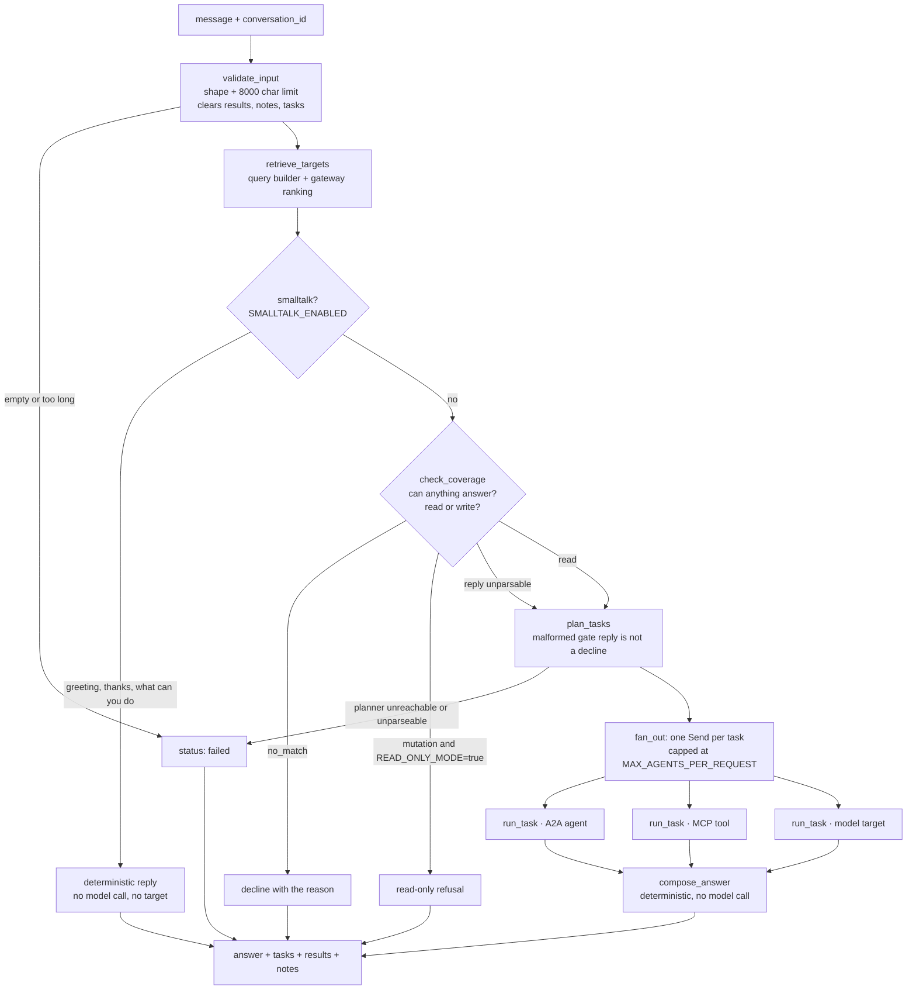

`compose_answer` waits for every branch because `results` is an add-reducer list. Status is
`completed` if **any** result succeeded, so a partial failure is reported rather than hidden.

## Retrieval: how modes are chosen

Decided per protocol, per turn — never globally.

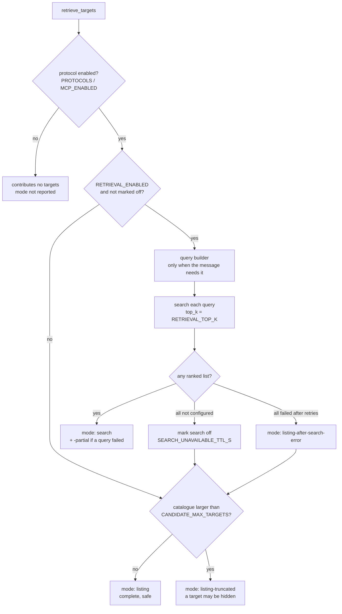

`MODEL_TARGETS` bypasses this entirely: models are always listed, never searched, because
there is no relevance endpoint for "which model fits".

## Config A · search everywhere

Both surfaces ranked. The normal production shape when the gateway is fully configured.

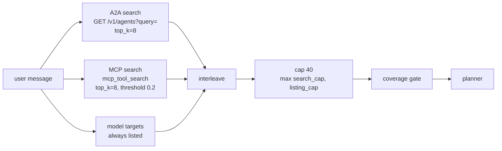

Turn note: `retrieve: 3 target(s) via a2a=search, mcp=search, model=listing`

## Config B · A2A unranked

MCP search is DB-backed (`mcp_tool_search_enabled` on the key); A2A search needs
`agent_search_embedding_model` in the gateway's `config.yaml` **plus a restart**. Mixed
modes are normal, not a fault.

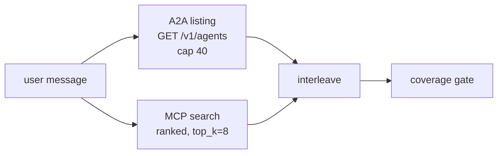

Turn note: `retrieve: 3 target(s) via a2a=listing, mcp=search`

`listing` (not `listing-truncated`) proves the agent catalogue fit under the cap, so
unranked listing is safe here.

## Config C · listing only

`RETRIEVAL_ENABLED=false`, or every surface reported "not configured", or each protocol
disabled. The fallback path.

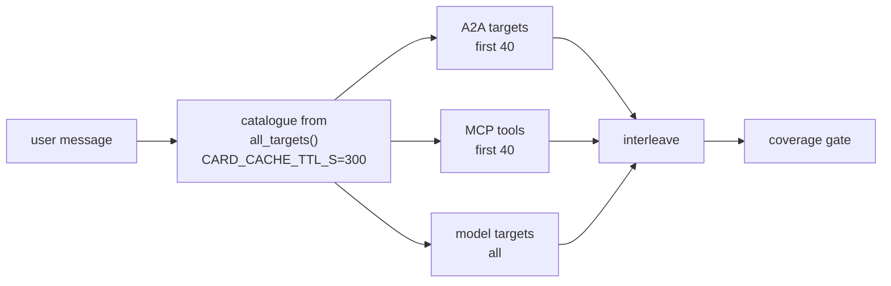

Turn note: `retrieve: N target(s) via a2a=listing, mcp=listing`

Listing is **unranked**, so order is arbitrary — this is why the cap is 40 and not 8.

## Config D · search fails this turn

Transient failure (timeout, 429, 5xx) after `SEARCH_RETRIES`; search is retried next turn,
not switched off.

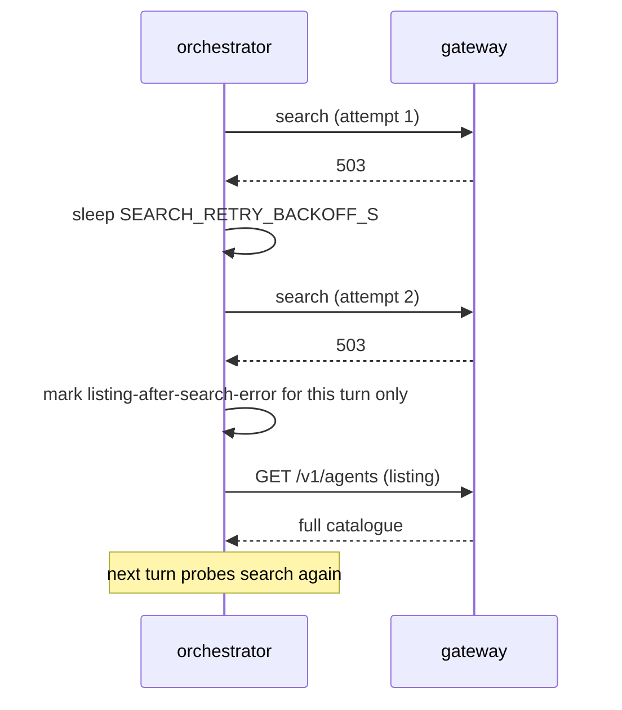

Contrast with "not configured" (no embedding model, key without tool search): that marks
the surface off for `SEARCH_UNAVAILABLE_TTL_S` so it is not re-probed every turn. Before
this split existed, one transient error disabled search for a minute and every turn in that
window fell back to a truncated listing.

## Config E · catalogue larger than the cap

`CANDIDATE_MAX_TARGETS=40` with 100+ registered targets and no search. The turn says so
instead of failing silently.

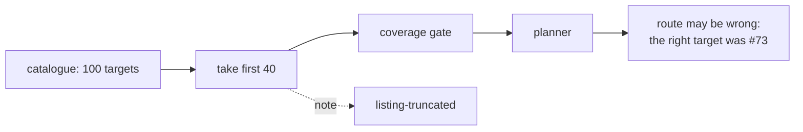

Measured: 10 or 40 targets → `listing`, correct. 100 or 500 → `listing-truncated`, and the
correct target is found only once search is enabled. Treat the mode as an actionable signal,
not a warning to ignore.

## Cap map

What each limit applies to. They are not interchangeable.

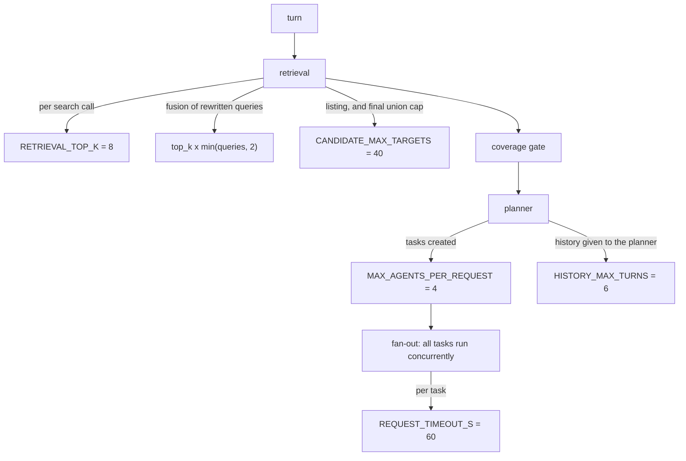

There is **no concurrency limiter**: `MAX_AGENTS_PER_REQUEST` bounds how many branches
exist, not how many run at once. Lowering it reduces load and breadth together.

## Identity modes

Four `AUTH_MODE` values, one `UserContext` shape. Only `entra` and `dev` enforce a role.

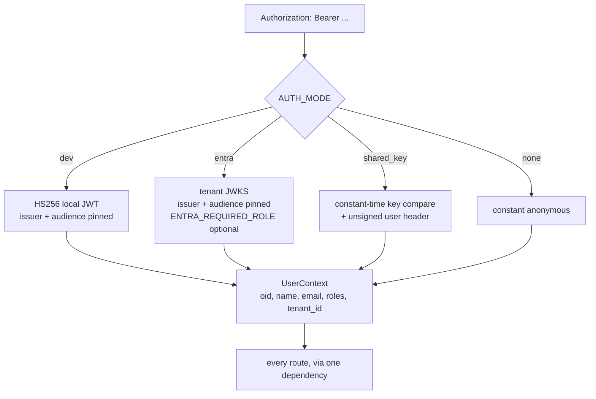

| Mode | Proves | Gap |
|---|---|---|
`dev` | the token is self-signed by this process | not for anything shared |
`entra` | signature, issuer, audience, expiry | behind LibreChat SSO it validates **LibreChat's** audience, so any LibreChat token opens the orchestrator (OBO gap) |
`shared_key` | the caller holds the key | identity is an unsigned header — a key holder can impersonate any user |
`none` | nothing | localhost only |

Every mode produces the same `UserContext`, so switching modes changes only which validator
is constructed.

## Authorization layers

Three questions, three places. Only layers 1 and 3 are implemented.

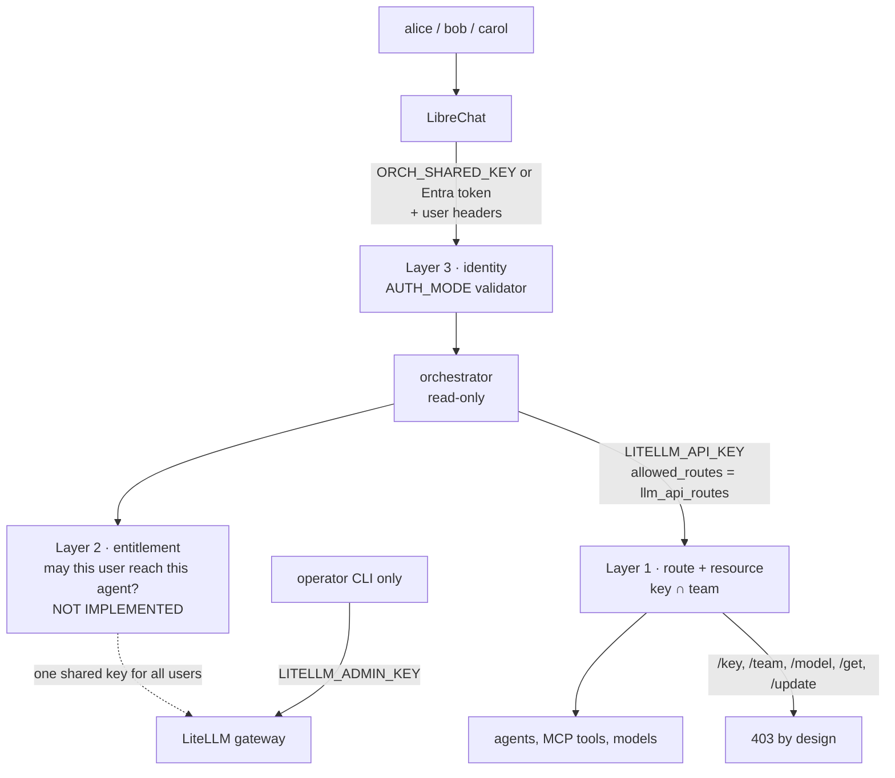

## Trace resolution

`traceparent` wins outright, which is why a static one breaks the join. LibreChat's path is
the message id, not W3C.

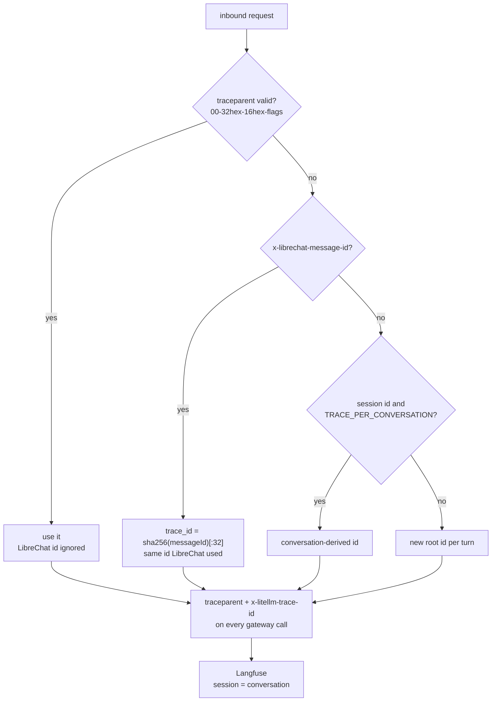

| Send from LibreChat | Result |
|---|---|
`X-LibreChat-Message-Id` only | one trace, joined |
`traceparent` derived from the same digest | one trace |
`traceparent` with any other id | **two disconnected trees** |
neither, `TRACE_PER_CONVERSATION=true` | two trees |
neither, `TRACE_PER_CONVERSATION=false` | new root each turn |

Langfuse is the sink, not the carrier: it is told the id via `trace_context`, and it is not
involved in propagation. With `LANGFUSE_*` blank the tracer is a no-op and `traceparent`
still goes out, so gateway logs stay correlated.

## Memory backends

`CHECKPOINT_BACKEND` decides where conversation state lives. History survives a turn either
way; only Postgres survives a restart.

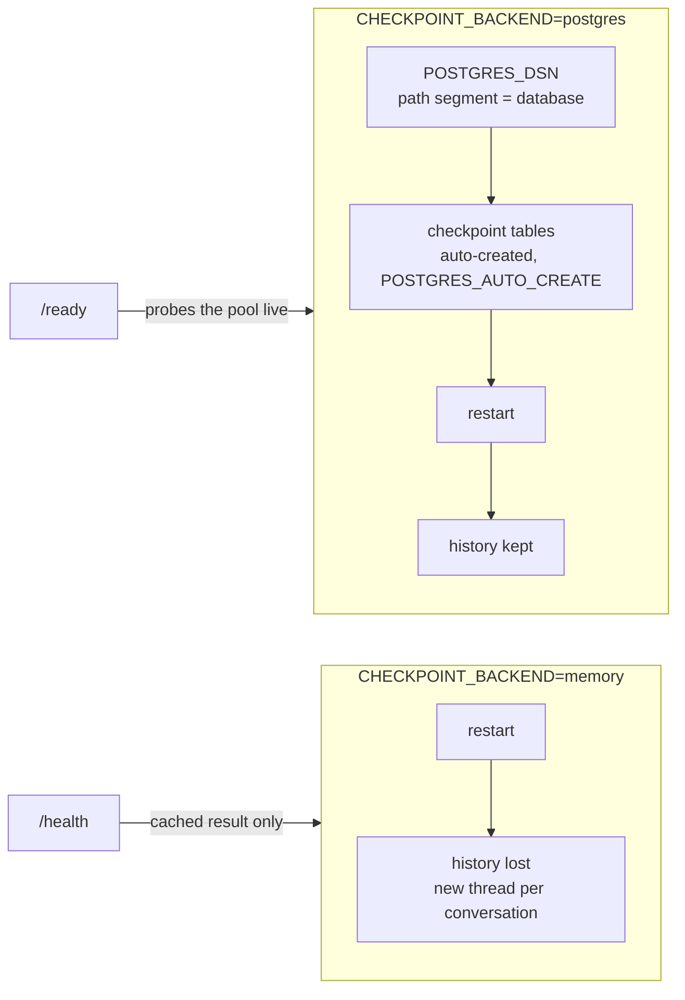

On Windows, `python -m orchestrator` supplies the event loop psycopg needs; the plain
`uvicorn` CLI hard-codes one it refuses.

## Gateway access layers

Two independent gates on one call, checked in this order.

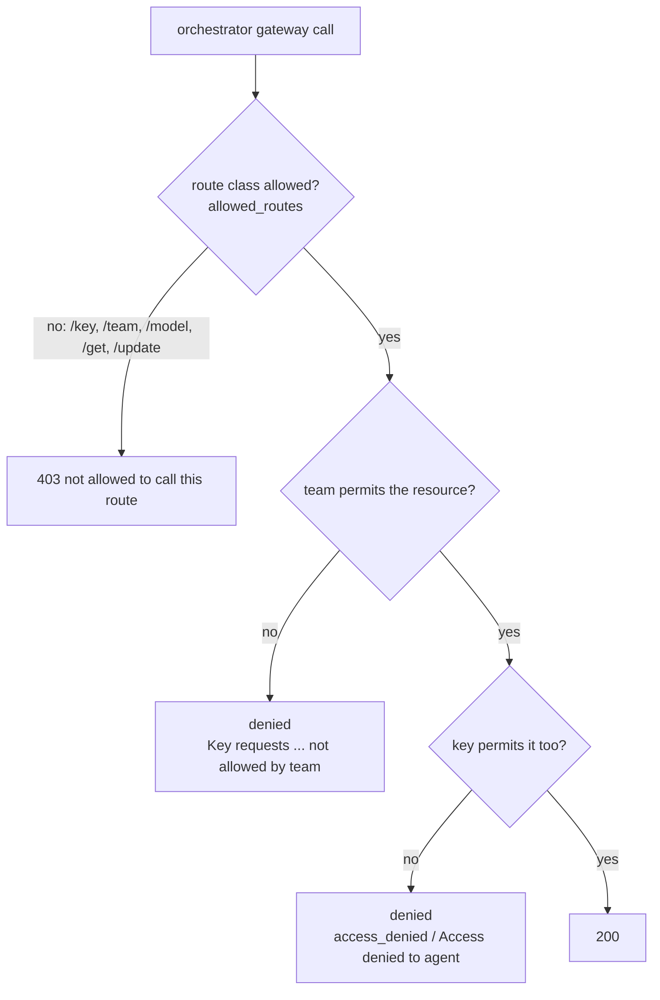

Effective access is **key ∩ team**, and the team must be granted first. `agents: []` is
ambiguous — measured as denied on new keys and unrestricted on the orchestrator's own key —
so grant agent ids explicitly if agent access matters.

## Model targets

`MODEL_TARGETS` is empty by default; when set, models become routable targets beside agents
and tools.

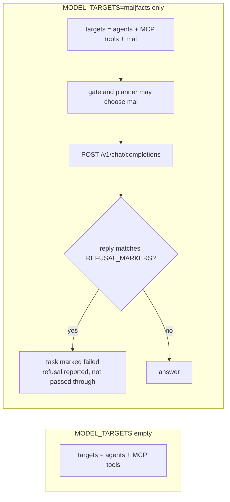

Refusal detection applies to model targets only — never to A2A agents or MCP tools.

## Boot and readiness

The model check runs **after** startup, so a slow or wrong model name cannot delay boot.

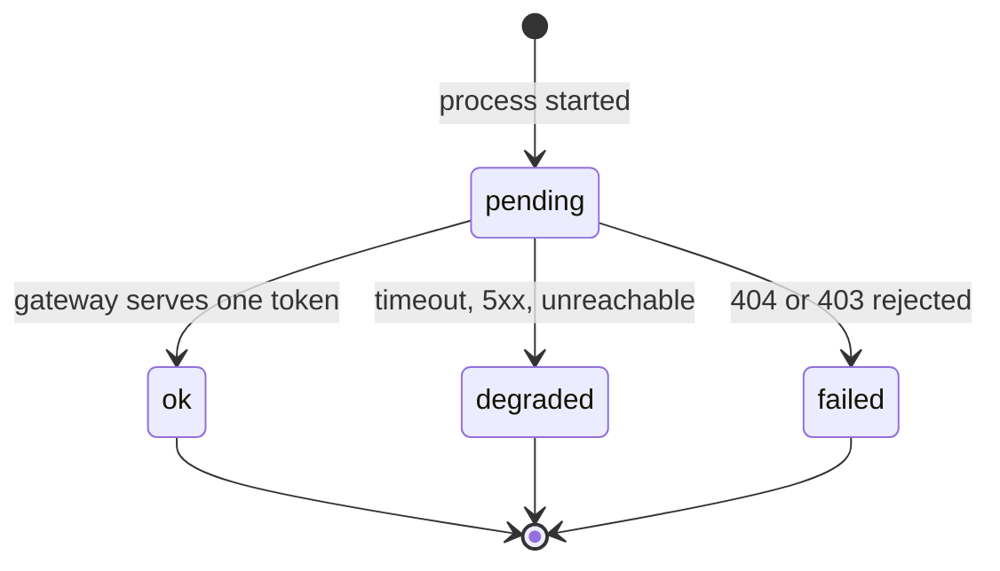

| State | `/health` | `/ready` | Why |
|---|---|---|---|
`pending` | 200 | 200 | check unfinished; normal startup |
`ok` | 200 | 200 | gateway answered |
`degraded` | 200 | **200** | the gateway hiccuped, not this pod — pulling every pod would turn a blip into an outage |
`failed` | 200 | **503** | permanently broken config, but the pod stays alive for debugging |
memory unreachable | 200 | **503** | every turn would 500 |

`/health` reports the **cached** memory probe; only `/ready` probes live, so liveness cannot
flap on a database blip.

## Feature toggles

| Setting | `true` (default) | `false` |
|---|---|---|
`RETRIEVAL_ENABLED` | gateway ranks agents and tools | list the catalogue — debugging only |
`QUERY_REWRITE_ENABLED` | follow-ups and multi-question messages become standalone queries, merged by rank fusion | search the raw message |
`COVERAGE_GATE_ENABLED` | one call asks "can anything answer?" — measured 7/7 rejection of irrelevant queries | planner decides alone — measured 2/7 |
`SMALLTALK_ENABLED` | greetings answered deterministically, no model call | greetings go through the gate and may be declined |
`READ_ONLY_MODE` | mutating intents refused with an explanation | mutation verdict ignored — no approval flow exists |
`MODEL_PREFLIGHT_ENABLED` | background model check reported on `/health` | skip the check |
`LANGFUSE_TRACING_ENABLED` | spans exported; blank keys make the tracer a no-op | untraced; `traceparent` still propagates |

## Pointers

- [routing.md](routing.md) — every mode and cap in prose, with measured accuracy
- [tracing.md](tracing.md) — trace join, Langfuse environment validation, per-user attribution
- [authorization.md](authorization.md) — the three layers and what is not implemented
- [memory.md](memory.md) — checkpointer behaviour, DSN pitfalls, health semantics
