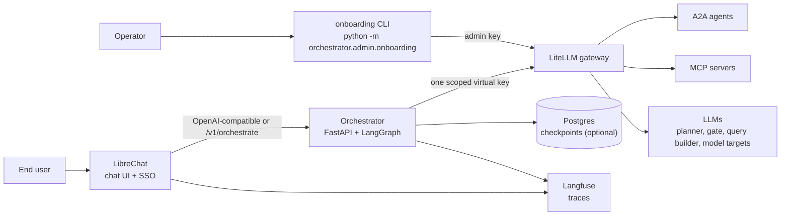
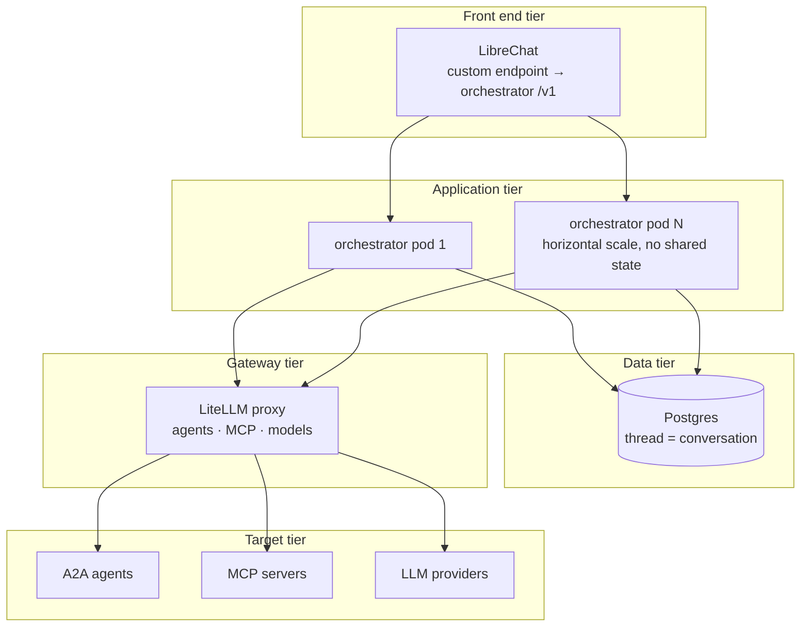

# High-level design (HLD)

What the system is, who talks to it, what runs where, and what it deliberately does not do.
For the shapes of individual configurations see [diagrams.md](diagrams.md); for module and
function-level contracts see [lld.md](lld.md).

## 1. Purpose

A single **routing layer** between a chat front end and a gateway holding many agents, tools
and models. The user asks a question; the system decides *whether anything can answer it*,
*which target should*, and *composes the answer from what came back* — without inventing
facts and without write access.

| In scope | Out of scope (by design) |
|---|---|
read-only question answering over registered targets | create/update/delete/approve actions |
routing to A2A agents, MCP tools and allowlisted models | opening a browser session or acting as a UI |
discovery from the gateway at runtime | configuring what exists (operator vocabulary) |
one trace per message across hops | per-user entitlement — **not implemented** |
conversation continuity via a checkpointer | long-term memory or retrieval over past conversations |

## 2. Actors and systems

| Actor | Trust | Credential it holds |
|---|---|---|
end user | authenticated by LibreChat, or by the orchestrator's validator | LibreChat session |
LibreChat → orchestrator | trusted network hop | `ORCH_SHARED_KEY`, or a forwarded Entra token |
orchestrator → gateway | least privilege | `LITELLM_API_KEY` (virtual, `allowed_routes=["llm_api_routes"]`) |
operator | shell access | `LITELLM_ADMIN_KEY`, CLI-only, never in the service environment |

## 3. Container view

| Container | Technology | Responsibility | Stateless? |
|---|---|---|---|
| orchestrator | FastAPI + LangGraph, Python | routing, refusal policy, composition | yes, except conversation state |
| gateway | LiteLLM proxy | discovery, ranking, invocation, spend control | yes, DB-backed config |
| agent / MCP server | any A2A or MCP implementation | domain answers | their concern |
| Postgres | optional | LangGraph checkpoints | durable |
| Langfuse | optional | trace storage and query | durable |

The orchestrator holds **no registry**. There is no local config listing agents, tools or
models to route to (models are the one exception: an explicit `MODEL_TARGETS` allowlist).
Registration lives in the gateway; discovery is a runtime call.

## 4. Runtime topology

Scale-out notes: pods are interchangeable; the only cross-pod state is the checkpointer, so
`CHECKPOINT_BACKEND=postgres` is required for more than one replica if conversation history
must survive a request landing on a different pod. With `memory`, a conversation sticks to
the pod that served its first turn, and a restart loses it.

Probes: `/health` is liveness (always 200 while the process runs), `/ready` is readiness
(503 on a permanently rejected model or unreachable checkpointer). Model probing happens
**after** startup so a slow gateway cannot delay boot.

## 5. Responsibilities, layer by layer

| Layer | Owns | Must not own |
|---|---|---|
front end (LibreChat) | session, SSO, message id for trace join | routing decisions |
orchestrator | coverage decision, target selection, composition, refusal | ranking by similarity, permissions, budgets |
gateway | registry, ranking (`top_k`, thresholds), invocation, spend | policy about what a user may ask |
targets | answering within their domain | being aware of other targets |

Three rules follow from this split and explain most of the design:

1. **Ranking belongs to the gateway** because it owns embeddings and the score. The
   orchestrator never re-ranks or re-filters — doing so previously hid the correct target.
2. **The coverage decision belongs to the orchestrator** because the planner is measurably
   bad at declining (2/7 rejected irrelevant queries alone, 7/7 with a gate).
3. **Composition is deterministic** because a summarising merge would reintroduce
   hallucination.

## 6. Key flows

| Flow | Trigger | Path | Idempotent? |
|---|---|---|---|
answer a question | `POST /v1/orchestrate` or `/v1/chat/completions` | graph: validate → retrieve → gate → plan → fan-out → compose | yes, read-only |
refuse a mutation | planner returns a mutating intent | gate/planner → `read_only_policy` denial | yes |
greeting | smalltalk detector | answered before the gate, no model call | yes |
register an agent | operator CLI `register` | `POST /v1/agents` with admin key | no — duplicate names fail loudly |
grant access | operator, raw admin API | team first, then key (`object_permission`) | yes — merges |
probe models | startup background task | one token per configured model | yes |

Full node-level detail: [routing.md](routing.md). Mode-by-mode diagrams: [diagrams.md](diagrams.md).
The LibreChat hop, step by step with what the user sees at each failure:
[lld.md](lld.md#31-librechat--orchestrator-step-by-step).

## 7. Data and contracts

| Contract | Direction | Shape | Stability |
|---|---|---|---|
`POST /v1/orchestrate` | front end → orchestrator | `{message, conversation_id, refresh_catalog}` → `{run_id, status, answer, tasks, results, notes, trace_id}` | internal, versioned by deployment |
`POST /v1/chat/completions` | front end → orchestrator | OpenAI-compatible, SSE when `stream: true` | external, stable |
`GET /v1/agents`, `/v1/capabilities` | front end → orchestrator | discovery view | additive |
`/health`, `/ready` | platform | liveness / readiness with model and memory state | stable |
`POST /v1/agents`, `/team/update`, `/key/update` | operator → gateway | registration and grants | LiteLLM-owned |

Nothing the orchestrator writes to the gateway changes configuration; it only reads and
invokes. That is what keeps a compromise from minting keys or rewriting grants.

## 8. Cross-cutting concerns

| Concern | Approach | Where |
|---|---|---|
identity | one router dependency → `UserContext` for all modes | [authorization.md](authorization.md) |
propagation | W3C `traceparent` + `x-litellm-trace-id` on every gateway call | [tracing.md](tracing.md) |
join with front end | recompute `sha256(messageId)[:32]` rather than invent an id | [tracing.md](tracing.md) |
resilience | retries on search and planner; listing fallback per turn | [routing.md](routing.md) |
observability | one trace per message, one session per conversation | [tracing.md](tracing.md) |
state | checkpointer keyed by conversation, turn-scoped fields reset per turn | [memory.md](memory.md) |
configuration | single `Settings` object, validated at boot | [lld.md](lld.md#5-configuration-map) |

## 9. Non-functional targets

| Attribute | Target | Mechanism |
|---|---|---|
latency | routing adds 2 model calls (gate + planner) plus discovery | query rewrite only when needed; smalltalk short-circuits |
availability | a gateway blip must not fail readiness | `degraded` stays ready; only `failed` fails |
blast radius | no write path, no admin key in the runtime | read-only policy, scoped virtual key |
cost | bounded fan-out and bounded prompts | `MAX_AGENTS_PER_REQUEST`, `RETRIEVAL_TOP_K`, `CANDIDATE_MAX_TARGETS` |
traceability | one user message maps to one trace tree | trace context propagation |
honesty | a routing miss is reported, not disguised | `listing-truncated`, `search-empty`, failure statuses |

## 10. Known gaps and risks

| Gap | Consequence | Track |
|---|---|---|
no per-user entitlement | every user reaches every agent the key can | [authorization.md](authorization.md), [entitlement-design.md](../guides/entitlement-design.md) |
`shared_key` trusts an unsigned header | a key holder can impersonate any user | [sso-integration.md](../guides/sso-integration.md) |
`entra` behind LibreChat validates LibreChat's audience | any LibreChat token opens the orchestrator (OBO gap) | [sso-integration.md](../guides/sso-integration.md) |
`agents: []` is ambiguous | access cannot be audited from `/key/info` alone | [api-key-scoping.md](../guides/api-key-scoping.md) |
no concurrency limiter | fan-out is capped in count, not in flight | [diagrams.md](diagrams.md#cap-map) |
retrieval is unranked on a surface without embeddings | `listing-truncated` above the cap | [routing.md](routing.md) |

## 11. Deployment view

| Piece | Artifact |
|---|---|
orchestrator image | `deploy/Dockerfile` |
sample agent | `deploy/Dockerfile.ronaldo-agent` |
sample MCP server | `deploy/Dockerfile.mcp-field-ops` |
local stack | `docker-compose.yml` (orchestrator + Postgres + both samples) |
configuration | `.env.example`, grouped by concern |

Operator procedure and networking (including `host.docker.internal` for container→host
targets): [deployment.md](../guides/deployment.md).

## 12. Design decisions

Every non-obvious choice has a record with the measurement that settled it:
[decisions/README.md](../decisions/README.md). The ones that shape this HLD most:

| ADR | Decision |
|---|---|
[0001](../decisions/0001-coverage-gate-before-planning.md) | ask a coverage question before planning |
[0002](../decisions/0002-no-relevance-score-threshold.md) | no relevance-score threshold |
[0003](../decisions/0003-deterministic-merge.md) | merge has no model |
[0004](../decisions/0004-one-trace-per-message.md) | one trace per message, one session per conversation |
[0005](../decisions/0005-planner-only-routing.md) | routing happens only in the planner |
[0006](../decisions/0006-read-only-by-capability.md) | read-only guaranteed by capability, not by classification |
