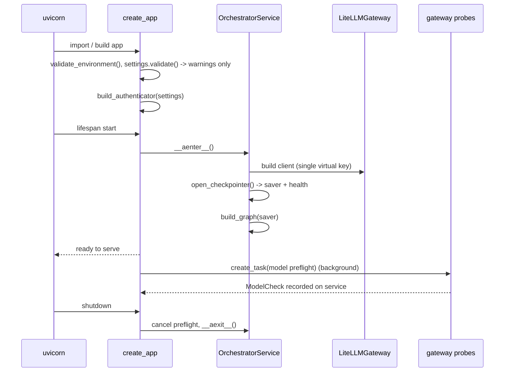
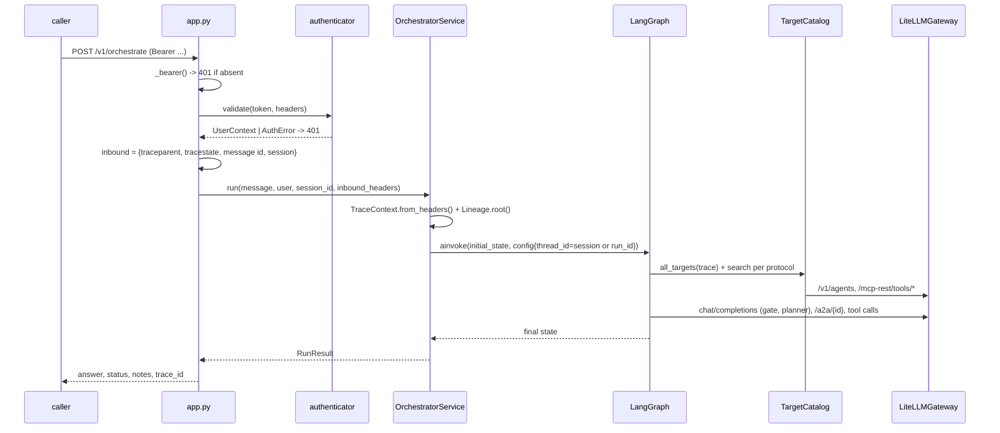
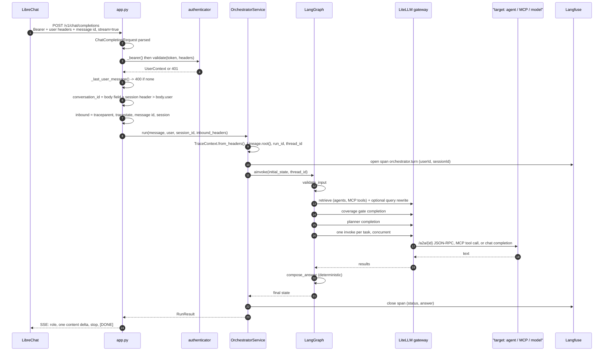
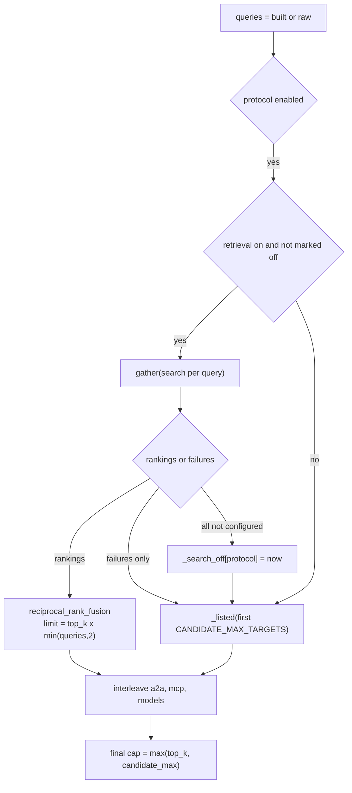

# Low-level design (LLD)

Module contracts, state schema, node behaviour and the exact error strings. Companion to
[hld.md](hld.md) (what and why) and [diagrams.md](diagrams.md) (pictures per configuration).
All paths are relative to the repository root.

## 1. Module map

| Module | Responsibility | Key symbols |
|---|---|---|
`src/orchestrator/api/app.py` | HTTP surface, one auth dependency for every route, lifespan wiring | `create_app`, `current_user`, `_bearer`, `_last_user_message` |
`src/orchestrator/service.py` | the object the API calls: graph lifecycle, boot checks, one turn | `OrchestratorService`, `RunResult`, `ModelCheck` |
`src/orchestrator/graph/build.py` | graph wiring | `build_graph` |
`src/orchestrator/graph/state.py` | state schema and reducers | `OrchestratorState`, `TaskSpec`, `turn_scoped`, `RESET` |
`src/orchestrator/graph/nodes.py` | the six nodes | `OrchestratorNodes.*`, `fan_out_tasks` |
`src/orchestrator/graph/checkpointer.py` | memory / Postgres saver, health probe | `open_checkpointer`, `CheckpointerHealth`, `MemoryHealth` |
`src/orchestrator/routing/target_catalog.py` | discovery, retrieval modes, caps, caches | `TargetCatalog`, `RetrievalResult` |
`src/orchestrator/routing/query_builder.py` | message + history → standalone queries | `QueryBuilder`, `needs_rewrite`, `parse_queries` |
`src/orchestrator/routing/rank_fusion.py` | merge ranked lists | `reciprocal_rank_fusion`, `RRF_K=60` |
`src/orchestrator/routing/coverage_gate.py` | "can anything answer this?" | `CoverageGate`, `CoverageVerdict`, `parse_decision` |
`src/orchestrator/routing/read_only_policy.py` | mutation verdict → refusal | `is_mutation`, `denial_message` |
`src/orchestrator/routing/smalltalk.py` | greetings, thanks, capabilities | `SmallTalk`, `detect`, `strip_leading_greeting` |
`src/orchestrator/gateway/client.py` | the only module that speaks to LiteLLM | `LiteLLMGateway`, `GatewayError` |
`src/orchestrator/gateway/models.py` | typed records | `Target`, `AgentCard`, `Skill`, `InvocationResult` |
`src/orchestrator/auth/validators.py` | four validators, one protocol | `build_authenticator`, `SharedKeyValidator`, `EntraValidator`, `DevValidator`, `NullAuthenticator` |
`src/orchestrator/auth/claims.py` | claim → `UserContext` | `UserContext`, `AuthError`, `extract_user_context` |
`src/orchestrator/observability/trace_context.py` | trace ids, lineage, outbound headers | `TraceContext`, `Lineage`, `call_headers` |
`src/orchestrator/observability/langfuse_tracer.py` | span export, no-op when disabled | `build_tracer`, `Tracer` |
`src/orchestrator/config.py` | settings, env parsing, validation | `Settings.from_env`, `validate_environment` |
`src/orchestrator/admin/onboarding.py` | operator CLI: check / register / verify / smoke | `main`, `register_agent`, `list_agents`, `send_message` |

Dependency direction is one-way: `api → service → {graph, routing, gateway, auth, observability}`.
`routing` and `graph` never import `api`. `gateway` is the only place `httpx` talks upstream.

## 2. Startup and process model



Boot never blocks on the gateway. A rejected model is recorded, not raised: `/health` stays
200, `/ready` returns 503 only for `failed` or an unreachable checkpointer.

## 3. Request path



`/v1/chat/completions` differs only in ingress: it takes the last user message, resolves
`conversation_id` from the body field, then the session header, then `body.user`, and emits
either JSON or a 4-event SSE stream (`role`, one content delta, `stop`, `[DONE]`).

### 3.1 LibreChat → orchestrator, step by step

The supported front end is LibreChat pointed at the orchestrator as a **custom endpoint**.
Every step below is what actually runs, in order, for one chat message.

#### 3.1.1 What LibreChat is configured with

The authoritative snippet lives in
[sso-integration.md](../guides/sso-integration.md#option-a--shared-key--user-header-simplest);
the shape is:

```yaml
custom:
  - name: 'A2A Orchestrator'
    apiKey: '${ORCH_KEY}'                          # → Authorization: Bearer ${ORCH_KEY}
    baseURL: 'http://host.docker.internal:8000/v1'
    headers:
      X-LibreChat-User-Id: '{{LIBRECHAT_USER_ID}}'
      X-LibreChat-User-Email: '{{LIBRECHAT_USER_EMAIL}}'
      X-LibreChat-User-Name: '{{LIBRECHAT_USER_NAME}}'
      X-LibreChat-Message-Id: '{{LIBRECHAT_BODY_MESSAGEID}}'
      X-LibreChat-Conversation-Id: '{{LIBRECHAT_BODY_CONVERSATIONID}}'
```

| Header | Template | Read by | Required? |
|---|---|---|---|
`Authorization` | `apiKey` → `Bearer ${ORCH_KEY}` | `_bearer` → validator | always (401 without it) |
`X-LibreChat-User-Id` | `{{LIBRECHAT_USER_ID}}` | `SharedKeyValidator` | yes in `shared_key` mode |
`X-LibreChat-User-Email` | `{{LIBRECHAT_USER_EMAIL}}` | `UserContext.email`, Langfuse `userId` | optional |
`X-LibreChat-User-Name` | `{{LIBRECHAT_USER_NAME}}` | greeting personalisation | optional |
`X-LibreChat-Message-Id` | `{{LIBRECHAT_BODY_MESSAGEID}}` | trace join (`sha256(messageId)[:32]`) | strongly recommended |
`X-LibreChat-Conversation-Id` | `{{LIBRECHAT_BODY_CONVERSATIONID}}` | Langfuse session, checkpoint thread | recommended |
`traceparent` | **not needed** | wins over the message id if present | leave unset |

`baseURL` ends in `/v1`, so LibreChat's `POST {baseURL}/chat/completions` becomes
`POST /v1/chat/completions`. In `entra` mode `Authorization` becomes
`Bearer {{LIBRECHAT_OPENID_ACCESS_TOKEN}}` and the user headers are unnecessary.

#### 3.1.2 The whole hop



#### 3.1.3 Step detail

| # | Step | Where | What happens | LibreChat sees |
|---|---|---|---|---|
1 | send | LibreChat | one user message, `stream: true`, headers above | typing indicator |
2 | parse | `app.py` → `ChatCompletionRequest` | `model`, `messages`, `stream`, `conversation_id`, `user` | — |
3 | authenticate | `_bearer`, `current_user` | `Bearer` required; validator returns `UserContext` | `401` with the validator's reason |
4 | take the message | `_last_user_message` | **only the newest user message**; earlier turns come from the checkpointer, so re-sent history is ignored | `400 no user message in request` if none |
5 | resolve conversation | `chat_completions` | `body.conversation_id` → `X-LibreChat-Conversation-Id` → `body.user` | — |
6 | collect trace input | `chat_completions` | forwards `traceparent`, `tracestate`, message id, session | — |
7 | open the turn | `service.run` | `TraceContext.from_headers` (traceparent > message id > conversation), `Lineage.root()`, `run_id`, `thread_id = session or run_id` | — |
8 | start span | `service.run` | `orchestrator.turn` with `user_id` from `LANGFUSE_USER_ID_FIELD`, `session_id` = conversation | — |
9 | load history | `graph.ainvoke` | checkpointer returns prior `history` for `thread_id` | — |
10 | validate | `validate_input` | trims, rejects empty or >8000 chars, resets turn-scoped fields | answer text from `error` |
11 | discover | `retrieve_targets` | strips a leading greeting, builds standalone queries, asks the gateway; records `retrieve: …` note | — |
12 | decide coverage | `check_coverage` | smalltalk answered with no model call; otherwise one gate call; `no_match` → decline; `write` + read-only → refusal | the decline text |
13 | plan | `plan_tasks` | one planner call; `limit = min(max_agents, setting)`; MCP arguments checked against `inputSchema` | — |
14 | fan out | `fan_out_tasks` | one `Send` per task, all concurrent, no semaphore | — |
15 | invoke | `run_task` → `gateway.invoke` | A2A JSON-RPC `message/send`, MCP tool call, or chat completion, each with `traceparent` + `x-litellm-trace-id` | — |
16 | compose | `compose_answer` | verbatim for one success; `### agent` sections for many; `_Failed: …_` for failures | the composed text |
17 | return | `chat_completions` | `text = answer or error or "No answer was produced."` | streaming chunks |
18 | render | LibreChat | assistant bubble; the stream ends | message visible |

Two consequences worth stating plainly:

- **Steps 5 and 9 mean LibreChat's message list is not the memory.** Only the newest message
  is read; everything earlier is the orchestrator's checkpointed `history`, capped by
  `HISTORY_MAX_TURNS`. Re-sending the full transcript is harmless but not what provides context.
- **The SSE stream is honest, not token-by-token.** The orchestrator produces one complete
  answer, so it emits the role, one content delta containing the whole answer, a `stop`, then
  `[DONE]`. Faking per-token deltas would misrepresent when the answer exists.

#### 3.1.4 What crosses the wire

Request as LibreChat sends it (streaming):

```http
POST /v1/chat/completions HTTP/1.1
Authorization: Bearer ${ORCH_KEY}
Content-Type: application/json
X-LibreChat-User-Id: 8b5f...c21
X-LibreChat-Message-Id: 2f9c1e...
X-LibreChat-Conversation-Id: conv-abc

{"model":"a2a-orchestrator","stream":true,
 "messages":[{"role":"user","content":"how many leave days do I get?"}]}
```

Response, event by event:

```
data: {"choices":[{"index":0,"delta":{"role":"assistant","content":""},"finish_reason":null}]}
data: {"choices":[{"index":0,"delta":{"content":"You get 25 days..."},"finish_reason":null}]}
data: {"choices":[{"index":0,"delta":{},"finish_reason":"stop"}]}
data: [DONE]
```

With `stream: false` the same text arrives once as `chat.completion`, plus an
`x_orchestrator` block carrying `run_id`, `status`, `trace_id`, `denied`, `conversation_id`.
LibreChat ignores that block; a direct caller uses it for diagnostics.

#### 3.1.5 Failure at each step, and what the user sees

| Step | Failure | Wire result | LibreChat bubble |
|---|---|---|---|
3 | no/invalid key, or missing user id header | `401 {"detail": "..."}` | error toast, no message |
4 | body had no user message | `400 no user message in request` | error toast |
7-8 | tracing misconfigured | turn continues untraced | normal answer, no trace |
11 | discovery call fails hard | `status: failed`, `error: agent discovery failed: …` | the error text |
12 | gate unreachable or unparsable | **not** a failure — planning continues | normal answer |
13 | planner unreachable / unusable reply | `status: failed` with which of the two happened | the error text |
15 | one target fails | that result marked `ok: false` | other sections still shown, failure marked `_Failed: …_` |
15 | all targets fail | `status: failed`, `error: all targets failed` | composed failure text |
— | nothing produced any text | `"No answer was produced."` | that sentence |

A `rejected` status (read-only refusal) is a **200 with an explanation**, not an error: the
answer text is the refusal, and `denied: true` appears only in the non-streaming metadata.

#### 3.1.6 Proving the join from LibreChat's side

```powershell
# 1. the id LibreChat opened its trace with
python -c "import hashlib; print(hashlib.sha256(b'<message-id>').hexdigest()[:32])"

# 2. the id the orchestrator reports for the same message
curl -s -X POST http://localhost:8000/v1/orchestrate `
  -H "Authorization: Bearer $env:ORCH_KEY" -H "Content-Type: application/json" `
  -H "X-LibreChat-Message-Id: <message-id>" -H "X-LibreChat-Conversation-Id: conv-abc" `
  -d '{"message":"leave days?","conversation_id":"conv-abc"}' | Select-String trace_id
```

The two values must be identical. If they differ, LibreChat sent a `traceparent` of its own,
or the message id header did not resolve — see the precedence table in
[tracing.md](tracing.md#resolution-order).

## 4. API surface

| Route | Method | Auth | Request | Response | Notes |
|---|---|---|---|---|---|
`/v1/orchestrate` | POST | required | `OrchestrateRequest` | `OrchestrateResponse` | primary contract |
`/v1/chat/completions` | POST | required | `ChatCompletionRequest` | JSON or SSE | OpenAI-compatible adapter |
`/v1/agents` | GET | required | — | list of registered agents | discovery view |
`/v1/capabilities` | GET | required | — | per-protocol counts and search state | debugging |
`/health` | GET | none | — | liveness + cached memory | always 200 |
`/ready` | GET | none | — | readiness + live memory probe | 503 when not serving |

`current_user` is a single dependency on the router path, so a new route cannot be added
without inheriting the check. `_bearer` rejects anything that is not `Bearer <token>` with
401 and the literal `missing bearer token`.

`OrchestrateRequest`: `message` (min length 1), `conversation_id` (default `""`),
`refresh_catalog` (default `false`).

`OrchestrateResponse`: `run_id`, `status`, `answer`, `error`, `trace_id`,
`conversation_id`, `denied`, `tasks`, `results`, `notes`.

## 5. Configuration map

| Setting | Read in | Effect |
|---|---|---|
`LITELLM_BASE_URL` / `LITELLM_API_KEY` | `LiteLLMGateway.__init__` | every upstream call |
`LITELLM_ADMIN_KEY` | onboarding CLI only | registration, `/key/info`; never in `Settings.validate()` |
`PLANNER_MODEL` | `nodes.plan_tasks` | the only routing model; empty fails the turn |
`GATE_MODEL` | `CoverageGate` | empty reuses `PLANNER_MODEL` |
`MODEL_TARGETS` | `TargetCatalog._model_targets` | extra routable model targets (`model\|description`) |
`RETRIEVAL_ENABLED` | `TargetCatalog._retrieve_protocol` | off → listing for every surface |
`RETRIEVAL_TOP_K` | `_retrieve_protocol` | per-search shortlist (default 8) |
`CANDIDATE_MAX_TARGETS` | `_listed`, `cached_targets` | listing cap and final union cap (default 40) |
`QUERY_REWRITE_ENABLED/_MAX_QUERIES` | `QueryBuilder.build` | 0-3 standalone queries |
`SEARCH_RETRIES`, `SEARCH_RETRY_BACKOFF_S` | `_search_one` | transient-failure retries |
`SEARCH_UNAVAILABLE_TTL_S` | `_search_is_off` | how long a surface stays marked off |
`CARD_CACHE_TTL_S` | `TargetCatalog._is_fresh` | catalogue cache lifetime |
`MAX_AGENTS_PER_REQUEST` | `nodes.plan_tasks` | hard ceiling on tasks per turn |
`REQUEST_TIMEOUT_S` | `LiteLLMGateway` | per-request timeout |
`READ_ONLY_MODE` | `nodes.plan_tasks` | refuse mutating intents |
`SMALLTALK_ENABLED` | `nodes.check_coverage` | deterministic greeting answers |
`CHECKPOINT_BACKEND`, `POSTGRES_DSN`, `POSTGRES_AUTO_CREATE` | `open_checkpointer` | state durability |
`HISTORY_MAX_TURNS` | `nodes._history_block` | how much history the planner sees |
`AUTH_MODE` and per-mode keys | `build_authenticator` | which validator is constructed |
`LANGFUSE_*` | `build_tracer` | span export, `userId`, environment label |
`TRACE_PER_CONVERSATION` | `service.run` | fallback trace id when no message id arrives |

## 6. Graph specification

Nodes are class methods on `OrchestratorNodes`; the class is constructed with the catalog,
gateway, tracer and settings.

| Node | Reads | Writes | Model calls | Can end the turn |
|---|---|---|---|---|
`validate_input` | `user_query`, `history` | `status`, `error`, `results` (reset), `notes` (reset), `tasks`, `candidates` | 0 | yes: empty or >8000 chars |
`retrieve_targets` | `user_query`, `history` | `candidates`, `notes` | 0-1 (query rewrite) | no |
`check_coverage` | `candidates`, `user_query` | `coverage`, `answer`, `status`, `notes` | 1 (gate) | yes: smalltalk, `no_match` |
`plan_tasks` | `candidates`, `user_query`, `history`, `max_agents` | `tasks`, `status`, `answer`, `error`, `notes` | 1 (planner) | yes: mutation, planner failure |
`run_task` × N | one `Send` payload | `results` (add), `notes` (turn-scoped) | 1 per task | no — failures land in `results` |
`compose_answer` | `results` | `answer`, `status`, `history` | 0 | terminates |

Edges: `START → validate_input → retrieve_targets → check_coverage → plan_tasks`, then a
conditional edge from `plan_tasks` via `fan_out_tasks` to either `run_task` (one `Send` per
task) or `compose_answer`, then `run_task → compose_answer → END`.

`fan_out_tasks` returns `"compose_answer"` when status is `failed`/`rejected` or `tasks` is
empty; otherwise it returns `[Send("run_task", {...}) for task in tasks]`. Concurrency is
structural — there is no semaphore, so task count is the only bound.

### Node contracts in detail

`validate_input`
- empty `user_query` → `status="failed"`, `error="empty user query"`.
- length > 8000 → `status="failed"` with a length error.
- otherwise writes `[RESET]`-prefixed empties so `turn_scoped` clears `results`/`notes`
  while `history` (plain `operator.add`) keeps accumulating.

`retrieve_targets`
- builds queries via `QueryBuilder` only when `needs_rewrite()` says so;
- calls `TargetCatalog.retrieve()` with all queries;
- appends `RetrievalResult.note` (for example `retrieve: 3 target(s) via a2a=listing, mcp=search`)
  and, when rewriting happened, `retrieve: search queries: a | b`;
- returns candidates as plain dicts so they survive checkpointing.

`check_coverage`
- smalltalk is decided before any model call, from the normalised message and the
  caller's display name; a leading greeting is stripped first;
- otherwise `CoverageGate.assess()` returns a `CoverageVerdict` or `None`
  (`can_answer`, `targets`, `reason`, `confidence`, `intent`);
- the gate is called even with an empty candidate list, because intent still has to be
  triaged — otherwise a mutation would be answered as a coverage miss;
- `intent` of `write` with `READ_ONLY_MODE=true` short-circuits to the denial message with
  `status="rejected"` and `denied=True`;
- `None` (gate unreachable, or reply unparsable) is **not** a decline: the turn continues
  to `plan_tasks`.

`plan_tasks`
- resolves candidate ids back to `Target` records from the catalogue (unknown ids are noted
  and ignored);
- `limit = min(state["max_agents"] or setting, setting)`;
- one planner call, retried per the table in §8;
- drops tasks beyond the cap and tasks naming targets the gate did not pass through;
- MCP arguments are validated against `Target.input_schema` before the call leaves, so a
  missing argument fails locally (`missing_arguments()`).

`run_task`
- one `gateway.invoke(target, instruction, arguments, trace, lineage)`;
- always returns a `results` entry, converting `GatewayError` to `ok=False` with
  `error` and `http_status`;
- never raises, so one bad branch cannot fail the turn.

`compose_answer`
- one result → its text verbatim;
- one failed result → `"<agent> could not answer: <error>"`;
- many → `### <agent>` section per result, failures marked `_Failed: ..._`;
- `status="completed"` if **any** result succeeded;
- appends `{"role": "user"|"assistant"}` to `history` and makes no model call.

## 7. State schema

| Field | Type | Reducer | Scope |
|---|---|---|---|
`run_id` | `str` | replace | turn |
`session_id` | `str` | replace | conversation |
`user_query`, `user` | `str`, `dict` | replace | turn |
`trace`, `lineage` | `dict` | replace | turn (serialised, survives checkpointing) |
`history` | `list[dict]` | `operator.add` | conversation |
`candidates` | `list[dict]` | replace | turn |
`coverage` | `dict` | replace | turn |
`tasks` | `list[TaskSpec]` | replace | turn |
`max_agents` | `int` | replace | turn |
`results` | `list[dict]` | `turn_scoped` | turn, reset by `validate_input` |
`notes` | `list[str]` | `turn_scoped` | turn, reset by `validate_input` |
`answer`, `status`, `error` | `str` | replace | turn |

`TERMINAL_STATUSES = ("completed", "failed", "rejected")`. The checkpointer thread id is
`session_id or run_id`, so a conversation without an id gets one-turn memory.

`tasks` shape (`TaskSpec`): `task_id`, `agent_id`, `agent_name`, `protocol`,
`server_id`, `tool_name`, `instruction`, `arguments`.

`results` shape (`InvocationResult.to_state()`): `agent_id`, `agent_name`, `instruction`,
`ok`, `text`, `error`, `http_status`, `latency_ms`, `protocol`, `tool_name`.

## 8. Gateway client contract

| Method | Upstream | Returns | Failure surfaced as |
|---|---|---|---|
`list_agents` | `GET /v1/agents` | `list[Target]` | `GatewayError` → catalog records the surface unavailable |
`get_agent_card` | `GET /v1/agents/{id}` card | `AgentCard` | `GatewayError` → record kept without card |
`list_mcp_servers` | `GET /v1/mcp/server` | server rows | `GatewayError` |
`list_mcp_tools` | `POST /mcp-rest/tools/list` per server | `list[Target]` | `GatewayError` |
`search_agents` | `GET /v1/agents?query=&top_k=` | ranked `list[Target]` | `_is_search_unavailable` distinguishes "not configured" |
`search_mcp_tools` | `POST /mcp-rest/tools/call` → `mcp_tool_search` | ranked `list[Target]` | as above |
`list_models` | `GET /v1/models` | names | hint only |
`probe_model` | one-token `POST /v1/chat/completions` | `ModelCheck` | recorded, never raised at boot |
`invoke` | dispatches by `Target.protocol` | `InvocationResult` | wrapped into the result |
`complete` | `POST /v1/chat/completions` | `(text, raw)` | `GatewayError` with status and body snippet |

Retry policy, which is **per call site**, not global:

| Call | 429 | Unparsable reply | Other errors |
|---|---|---|---|
planner (`_call_planner`) | 4 retries, 1/2/4/8 s | 1 retry with a corrective suffix appended to the prompt | fail immediately |
gate (`CoverageGate.assess`) | none — returns `None` on `GatewayError` | `parse_decision` returns `None` | returns `None`; the caller continues to planning |
search (`_search_one`) | `SEARCH_RETRIES`, linear backoff | n/a | listing fallback |
`run_task` | none | none | `ok=False` |

Every request carries `call_headers(trace, lineage)`: `traceparent`, `x-litellm-trace-id`,
optional `tracestate`, `x-orchestrator-depth`, `x-orchestrator-parent-agent`. Credential
headers are never derived there, so a caller cannot smuggle `Authorization` upstream.

## 9. Retrieval internals



- `reciprocal_rank_fusion`: `score(target) = Σ 1/(60 + rank + 1)` over lists; ties broken by
  first appearance; a single list is returned unchanged; the copy with the highest
  `search_score` is kept for duplicates.
- `RetrievalResult.modes` records one mode per contributing surface; the note is
  `retrieve: {n} target(s)` plus ` via k=v, ...` sorted by key.
- `TargetCatalog` caches the catalogue for `CARD_CACHE_TTL_S` and remembers an unavailable
  search surface for `SEARCH_UNAVAILABLE_TTL_S`; `_absorb()` replaces cached records by id so
  a search hit with a card does not sit beside a card-less listing entry.

## 10. Data model

`Target` (frozen dataclass): `agent_id`, `agent_name`, `description`, `url`,
`protocol_version`, `skills`, `card`, `protocol` (`a2a`/`mcp`/`model`), `server_id`,
`server_name`, `tool_name`, `search_score`, `input_schema`, `raw`. Derived:
`is_mcp`, `is_model`, `required_arguments()`, `missing_arguments()`, `declined(text, markers)`,
`summary()`.

`Skill`: `id`, `name`, `description`, `tags`, `search_text()`.

`AgentCard`: `name`, `description`, `url`, `version`, `protocol_version`, `organization`,
`skills`, `raw`.

Constructors normalise the three upstream shapes: `from_api` (agent row),
`from_mcp_tool` (list response), `from_mcp_search_hit` (prefixed names, score),
`from_model` (allowlisted model with description).

`UserContext`: `oid`, `name`, `email`, `roles`, `tenant_id`, `scopes`, plus `claims`
including `identity_source` and `identity_verified`. `shared_key` sets
`identity_verified=False` deliberately.

`CoverageVerdict`: `can_answer`, `targets`, `reason`, `confidence`, `intent`, `valid`.
`is_no_match()` and `is_smalltalk()` are the two branching helpers.

## 11. Error taxonomy

| Surface | Message | Meaning |
|---|---|---|
API | `401 missing bearer token` | no `Bearer` header |
API | `400 no user message in request` | chat adapter received no user content |
graph | `empty user query` | validation |
graph | `planner did not return a usable decision (gateway error: ... 429)` | transport |
graph | `planner did not return a usable decision (replies could not be parsed as JSON; last reply started with ...)` | format |
gateway | `POST ... -> 429: <snippet>` | upstream status + body snippet, capped at 500 chars |
gateway | `Key requests MCP servers not allowed by team` | grant order violated |
gateway | `Access denied to agent` | key not granted the agent |
gateway | `Virtual key is not allowed to call this route` | wrong key for the path |

Notes are the user-visible explanation channel; `error` is reserved for turn failure.

## 12. Invariants

1. `validate_input` is the only place per-turn lists are reset; adding a node that appends
   without going through `RESET` will leak state across turns.
2. Only `gateway/client.py` performs upstream HTTP. A new gateway feature goes there.
3. `run_task` never raises; all failures become `results` entries.
4. `compose_answer` makes no model call and preserves attribution.
5. Ranking and filtering of candidates happen only in the gateway; the orchestrator passes
   one ordered list to the planner and records the gate's opinion in notes.
6. Every outbound call uses `call_headers()`; nothing else constructs trace headers.
7. The runtime never reads `LITELLM_ADMIN_KEY`.

## 13. Test map

| Area | Folder | Covers |
|---|---|---|
API and probes | `tests/api/` | routes, health semantics, preflight, boot checks |
auth | `tests/auth/` | four validators, shared-key properties |
config | `tests/config/` | parsing, validation, retrieval settings |
graph | `tests/graph/` | node behaviour, planning, compose, Postgres checkpoints |
routing | `tests/routing/` | catalog, cache, gate, query builder, fusion, scores, resilience, smalltalk |
observability | `tests/observability/` | trace context, join formula, Langfuse environment |
admin | `tests/admin/` | CLI and onboarding |
evals | `tests/evals/` | retrieval scoring harness |

Everything runs against an in-process fake gateway; Postgres tests skip unless
`TEST_DATABASE_URL` is set. `tests/observability/test_trace_join.py` pins
`sha256(messageId)[:32]` deliberately — a drift there splits traces silently.
